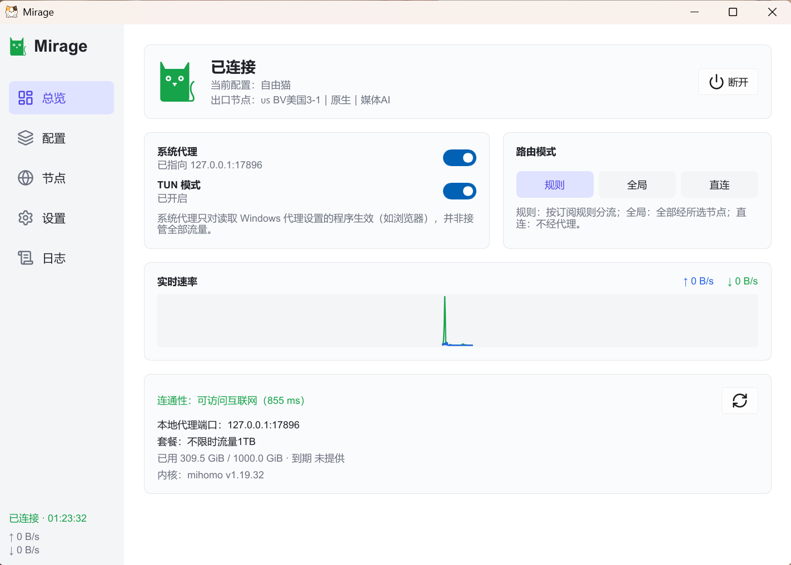
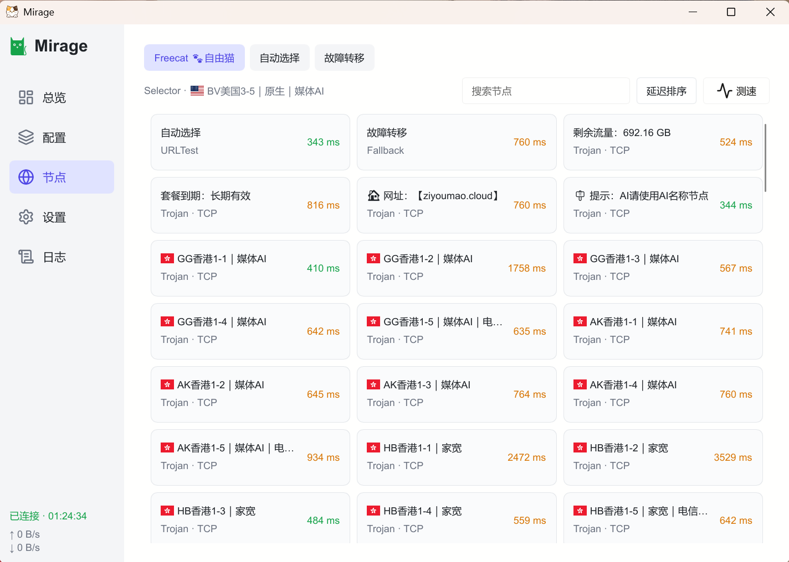
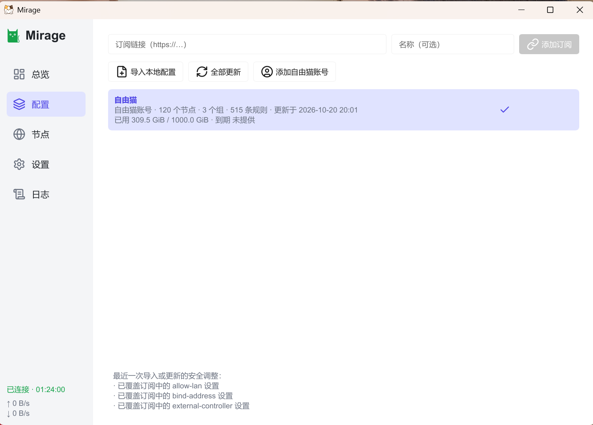
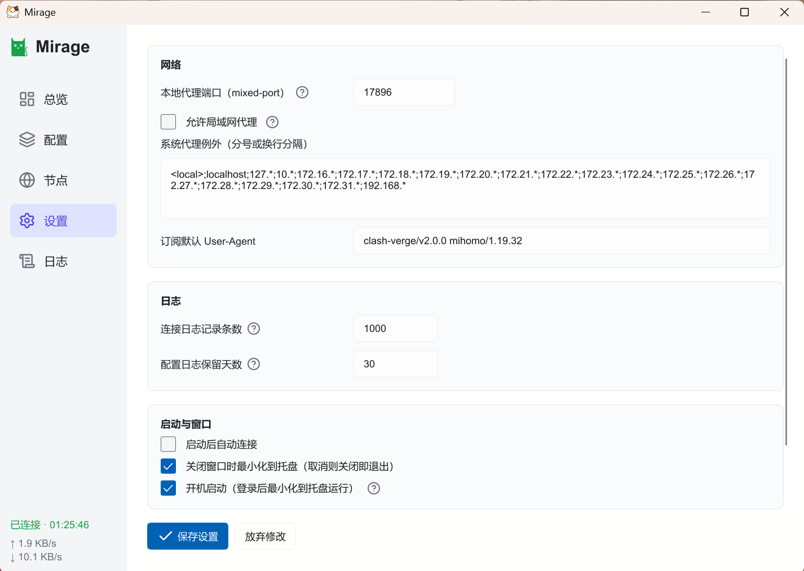
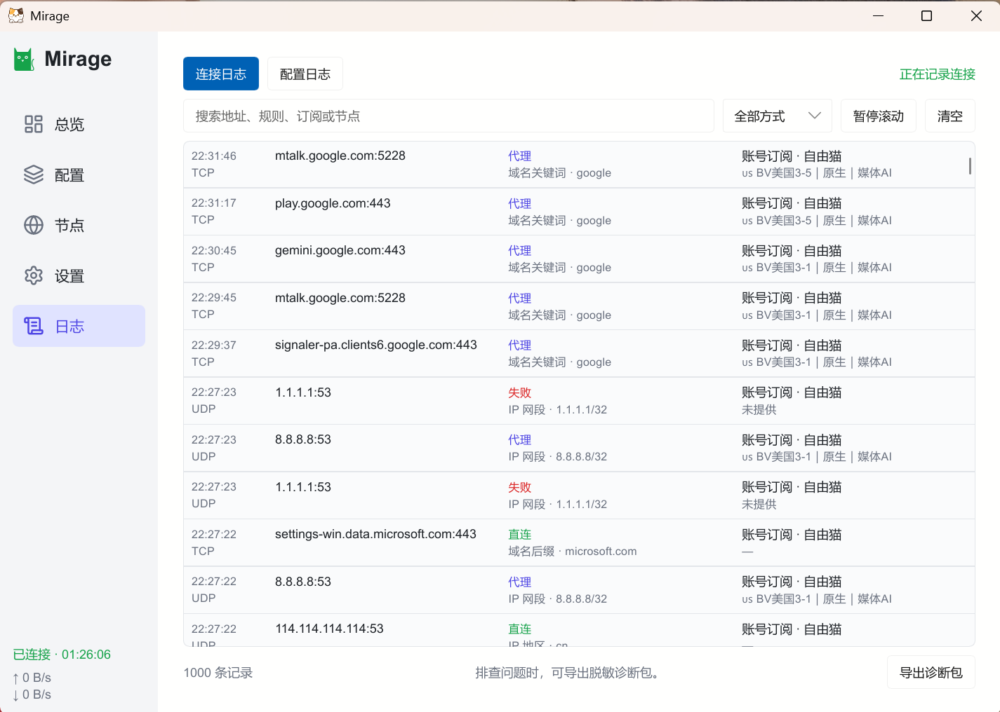

<div align="center">
  
  <h1>Mirage</h1>
  <p>基于 Rust + Slint 的原生 Windows 桌面代理客户端</p>
  <p>
    
    
    
    
    
    <a href="LICENSE"></a>
  </p>
  <p>
    <a href="https://github.com/x-Zer0/Mirage/releases">下载与发布</a> ·
    <a href="#使用">使用指南</a> ·
    <a href="docs/README.md">开发文档</a> ·
    <a href="docs/packaging.md">打包说明</a>
  </p>
</div>

Mirage 使用官方 **Mihomo** 内核，支持 **Windows 10 1809+ / Windows 11 x64**，现已提供正式体验版本。支持通用订阅、本地 YAML 配置，以及自由猫账号登录、订阅获取与节点管理；如需购买自由猫账号，可前往 [自由猫注册与购买](https://us.freecat.cloud/register?code=yfN2xcHQ)。

## 核心特色

- **原生桌面界面**：Slint 软件渲染，无需 WebView；支持托盘、开机启动、实时流量和内核日志。
- **统一配置管理**：订阅链接、本地 YAML、自由猫账号接入；支持定时更新、配置校验、热重载及失败回退。
- **灵活连接**：系统代理与 TUN 模式，支持规则 / 全局 / 直连、节点搜索、测速（默认去除握手延迟）和选择记忆。
- **自定义覆写**：全局附加规则（可视化 / YAML 编辑，优先于订阅规则）、应用内 Hosts（不改系统 hosts 文件）、IPv6 跟随订阅 / 开启 / 关闭。
- **权限隔离**：主程序以普通用户运行，TUN 通过独立辅助服务管理高权限内核；首次安装服务单独请求 UAC。
- **隐私与恢复**：凭据使用 Windows Credential Manager / DPAPI 保存，日志脱敏，异常退出后恢复本应用设置的系统代理并清理所属内核。
- **两种分发方式**：安装版与免安装 ZIP，随包提供内核、geodata 和第三方许可材料。

## 界面预览

<table>
  <tr>
    <td width="50%" align="center">
      <a href="docs/screenshots/dashboard.png"></a>
    </td>
    <td width="50%" align="center">
      <a href="docs/screenshots/node_list.png"></a>
    </td>
  </tr>
</table>

<table>
  <tr>
    <td width="33%" align="center">
      <a href="docs/screenshots/configuration.png"></a>
    </td>
    <td width="33%" align="center">
      <a href="docs/screenshots/setting.png"></a>
    </td>
    <td width="33%" align="center">
      <a href="docs/screenshots/log.png"></a>
    </td>
  </tr>
</table>

## 使用

从 [Releases](https://github.com/x-Zer0/Mirage/releases) 下载 Windows x64 版本：

| 版本 | 适用场景 | 启动方式 |
| --- | --- | --- |
| 安装版 `*-setup.exe` | 日常使用，需要快捷方式和系统卸载入口 | 按向导安装后启动 |
| 便携版 `*-portable.zip` | 希望自行管理程序目录 | 完整解压后运行 `Mirage.exe`，保留同目录的其他文件 |

在「配置」页添加订阅、导入 YAML 或登录自由猫账号，选择配置后连接。按需开启系统代理或 TUN；TUN 默认关闭。

「设置 → 网络」可开启“允许局域网代理”（默认关闭），保存后会重启运行中的内核。其他设备使用本机局域网 IP 和设置中的代理端口，并在 Windows 防火墙中允许该端口入站；TUN 模式需使用匹配版本的辅助服务。

两种版本均将设置、订阅和日志保存到 `%LOCALAPPDATA%\Mirage`，同一用户共用数据。凭据绑定当前 Windows 用户，不随程序目录迁移。

### 更新与卸载

- **更新**：先从托盘正常退出。安装版运行新版安装器覆盖安装；便携版用新版完整文件替换旧版。再次启用 TUN 时，按提示更新辅助服务。
- **卸载安装版**：从 Windows 应用列表卸载；如需移除 TUN 服务，按提示授权。默认保留用户数据。
- **移除便携版**：在设置中关闭开机启动、关闭 TUN 并卸载已安装的辅助服务，再从托盘退出并删除程序目录。仅删除文件夹不会清理服务或用户数据。

更多说明见 [打包与分发文档](docs/packaging.md)。

### 常见问题

- **为什么启用 TUN 会弹出 UAC？** TUN 依赖高权限辅助服务，首次安装或更新服务时需要管理员授权；取消后可继续使用系统代理模式，主程序无需以管理员身份运行。
- **连接失败或无法上网？** 先确认配置有效、账号或订阅未到期，在「节点」页测速并切换可用节点，再确认已开启系统代理或 TUN。仍有问题时，到「日志」页查看连接记录，并通过「导出诊断包」提供排查信息；TUN 服务异常可按设置页提示更新或重新安装。
- **关闭窗口后仍在运行？** 默认会最小化到托盘，完全退出请使用托盘菜单；也可在设置中调整关闭窗口的行为。

## 开发

需要 Rust **1.92+**（`x86_64-pc-windows-msvc`）、MSVC C++ 构建工具和 PowerShell 7。在仓库根目录执行：

```powershell
pwsh -File scripts/fetch-core.ps1
cargo build --locked
cargo run -p mirage-app --bin Mirage --locked
```

首次下载需要联网。`cargo build` 默认构建全部三个 package，产物为 `target/debug/Mirage.exe`、`target/debug/mirage-svc.exe`；开发运行使用根目录 `assets/core/` 的内核资源。

静态检查覆盖整个 workspace，不编写或运行单元测试：

```powershell
cargo fmt --all --check
cargo check --workspace --locked
cargo clippy --workspace --all-targets --locked -- -D warnings
```

## 工程结构

```text
crates/
  mirage-app/       主程序：Rust 业务、ui/ 界面、assets/ 图标、build.rs
  mirage-ipc/       共享协议、配置策略、内核校验与基础设施
  mirage-svc/       TUN 辅助服务，生成 mirage-svc.exe
assets/core/       下载的内核与 geodata（不入库）
scripts/           资源准备与打包脚本
packaging/         安装器、分发说明与第三方许可材料
docs/              设计、开发说明与验收记录
```

版本、依赖版本和 release profile 统一在根目录 `Cargo.toml` 管理，成员按需开启依赖特性。模块职责和依赖约定见 [架构设计](docs/DESIGN.md#4-代码组织)。

## 打包

准备 Inno Setup 6.4.3 和 cargo-about 0.9.2 后执行：

```powershell
pwsh -File scripts/package.ps1
```

一次生成 `dist/` 下的安装版、便携 ZIP 及 SHA256 校验文件。工具配置和分发说明见 [打包文档](docs/packaging.md)；第三方许可见 [THIRD-PARTY-NOTICES](packaging/THIRD-PARTY-NOTICES.txt)。

GitHub Actions 的检查、手动打包与标签自动发布流程见 [构建与发布说明](docs/github-actions.md)。

## 许可证

Mirage 自身代码采用 [MIT 许可证](LICENSE)。随附的 Mihomo、Slint、geodata 等第三方组件遵循各自许可证，详见 [第三方许可声明](packaging/THIRD-PARTY-NOTICES.txt) 和分发包内的 `licenses/`。
