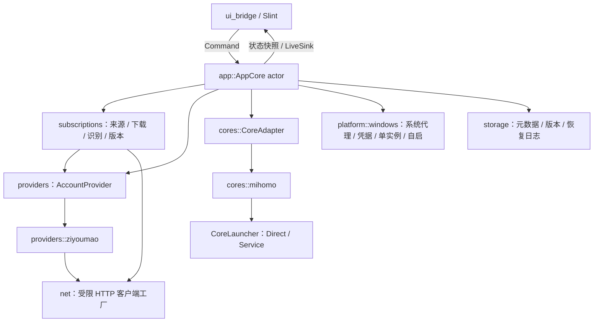
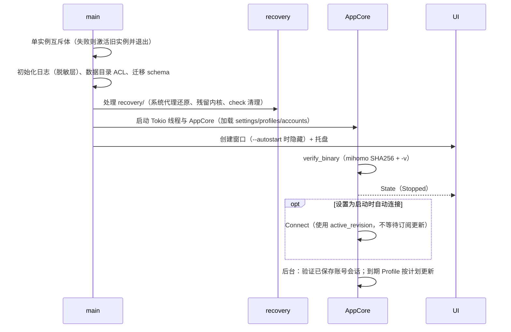
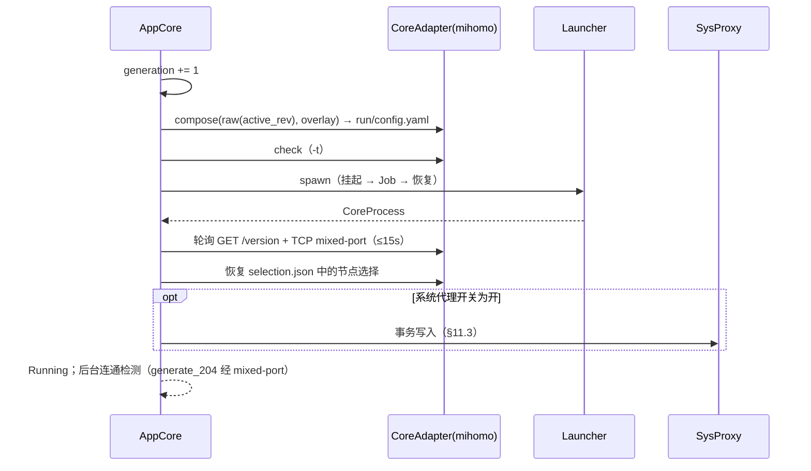
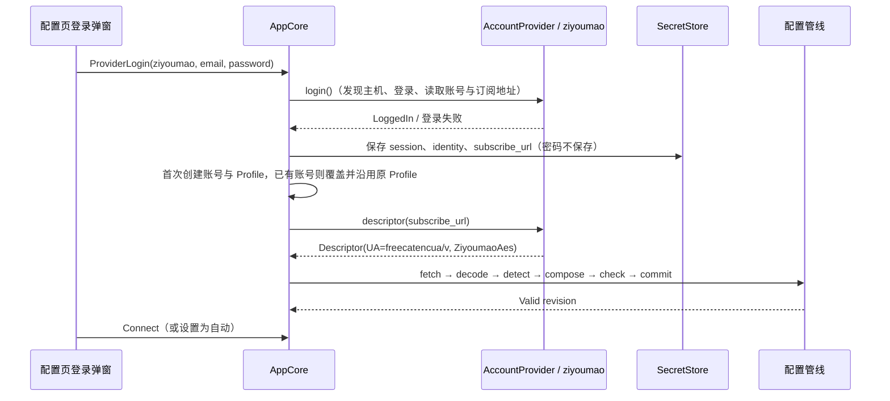

# Mirage 详细设计

版本：v1.0（2026-10-15），最后更新：2026-10-18（workspace 目录整理与工程命名统一）。来源：原《系统设计与开发路线》、《自由猫兼容规范》、分析报告，以及评审意见。本文是实现依据；与旧文档冲突时以本文为准。

自由猫协议细节见 [ZIYOUMAO.md](ZIYOUMAO.md)。

---

## 1. 产品定位与范围

### 1.1 定位

- Windows 优先的通用代理客户端，Rust + Slint 实现。
- 内核使用独立进程的官方 Mihomo；不使用、不分发自由猫定制核心。
- 普通 Mihomo 订阅（URL / 本地文件）无需任何服务商账号即可使用。
- 自由猫是一个随应用编译的服务商模块（`providers/ziyoumao`），负责账号登录与订阅发现，输出通用下载描述，之后走通用配置管线。
- 架构预留 sing-box 内核与更多服务商模块，但首发不实现。

“通用兼容”指兼容所固定 Mihomo 版本能接受的完整配置，不承诺理解任意机场的专有登录、加密订阅或旧 Clash 私有字段。

### 1.2 首发范围（v1）

| 类别 | 包含 |
| --- | --- |
| 配置来源 | 远程 URL 订阅、本地完整 YAML 导入、自由猫账号 |
| 内核 | 固定版本官方 Mihomo，配置校验、启动/停止、热重载、崩溃监督 |
| 节点 | 代理组列表、选择、测速、选择记忆 |
| 代理接入 | 系统代理（默认模式）；TUN（默认关闭，用户手动开启，见 §11.7） |
| 外壳 | 托盘、关闭到托盘、单实例、开机启动（可选） |
| 状态 | 流量速率、套餐/配额（服务端提供时）、订阅更新、日志、诊断 |
| 可靠性 | 配置版本与回退、系统代理事务恢复、异常退出后的启动恢复 |

### 1.3 明确不做（v1）

- 自由猫的充值、订单、邀请、客服、工单、注册、找回密码。
- 仅含节点链接（`trojan://`、`vmess://` 列表）的订阅转换；遇到时给出明确的“不支持的格式”错误。
- Mihomo YAML 与 sing-box JSON 互转。
- 内核自动更新（可手动替换并重新校验，见 §10.1）。
- 运行时动态插件、独立后台 Web 服务、多核心同时运行。

---

## 2. 默认决策

下表是开工时采用的默认值。每项都可以调整，但调整时需同步修改本文。

| 决策项 | 默认值 | 说明 |
| --- | --- | --- |
| 应用名 | Mirage（暂定） | 影响数据目录、互斥体名、凭据前缀；改名需一次性迁移 |
| 平台 | Windows 10 1809+ / Windows 11，x86_64 | ARM64 后续评估 |
| UI | Slint =1.18.1（Rust 1.92+），winit 后端，software 渲染器（M5 决定） | 不加载 OpenGL 驱动，RDP/虚拟机可用；对比数据见 `acceptance/M5.md`；界面图标统一用 Lucide |
| 异步 | Tokio 多线程运行时，运行在后台线程 | UI 主线程只跑 Slint 事件循环 |
| 内核 | Mihomo v1.19.32 windows-amd64 | 随安装包分发，启动时校验 SHA256（§10.1） |
| 代理接入 | 系统代理；TUN 默认关闭 | TUN 需要管理员权限，通过辅助服务实现（§11.7） |
| 本地端口 | mixed-port `17896`，仅监听 `127.0.0.1` | 避开 7890/7897 等常见客户端端口及自由猫使用的 17890；可在设置中修改 |
| 控制器 | `127.0.0.1:<随机空闲端口>` + 每次启动随机 secret | 通过 CLI `-ext-ctl` / `-secret` 覆盖，远端配置无法改写 |
| 凭据存储 | Windows Credential Manager；超过 2560 字节时回退为 DPAPI 加密文件 | 统一封装为 `SecretStore` |
| 数据目录 | `%LOCALAPPDATA%\Mirage\` | 布局见 §13 |
| 单实例 | 命名互斥体 + 激活事件 | 第二个实例只唤起主窗口后退出 |
| 内部 HTTP 出站 | 默认直连，显式禁用系统代理 | 策略见 §12 |
| 测速地址 | `https://cp.cloudflare.com/generate_204` | 分析期间实测返回 204 |
| 订阅更新间隔 | 默认 24 小时；服务端给出 `profile-update-interval` 时采用 | 每个 Profile 可单独设置，0 表示仅手动 |
| 测试策略 | 不编写单元测试 | 静态检查 + 手工端到端验收（§20） |

---

## 3. 总体架构

### 3.1 进程模型

```text
┌──────────────── Mirage.exe（当前用户，普通权限）────────────────┐
│  主线程：Slint 事件循环 + 托盘                                  │
│  后台线程：Tokio 运行时 → AppCore actor、HTTP、内核监督、IO      │
└───────────────┬──────────────────────────────┬──────────────────┘
                │ CreateProcess + Job Object    │ 命名管道 IPC（仅 TUN）
                ▼                               ▼
        mihomo.exe（普通权限）          MirageSvc（SYSTEM，可选安装）
        系统代理模式                     └─ 启动 mihomo.exe（TUN 模式）
```

- 同一时刻只有一个活动内核进程。
- 系统代理模式下，内核由应用直接启动（`DirectLauncher`）。
- TUN 模式下，内核由辅助服务以 SYSTEM 权限启动（`ServiceLauncher`），UI 不以管理员身份运行。
- 两种启动方式共用同一个 `CoreLauncher` 接口（§6.4），上层代码不感知差异。

### 3.2 模块关系



### 3.3 依赖方向

- `ui_bridge` 通过 `Command` 和应用状态快照连接业务；窗口、托盘等平台交互可在 UI 边界调用，不直接执行订阅或内核运行操作。当前节点视图复用 Mihomo 控制器 DTO，扩展第二种内核时收敛到应用层视图。
- `app` 编排领域模型、存储、订阅、平台与 Mihomo 适配器；`main.rs` 负责组装和启动。当前单内核采用具体实现，实际出现第二种实现时再提取接口。
- `providers::*` 只产出 `AccountSnapshot` 和 `DownloadDescriptor`，不得创建窗口、修改系统代理或启动内核。
- `cores::*` 不知道配置来自哪个服务商。
- 下载、响应限额、脱敏、原子写、进程管理这几项公共逻辑全工程只实现一份。

---

## 4. 代码组织

仓库根目录是纯 Cargo workspace，包含 `mirage-app`、`mirage-ipc`、`mirage-svc` 三个 package。根 `Cargo.toml` 统一版本、edition、最低 Rust 版本、依赖版本和 release profile；成员只声明自身需要的依赖特性。三个 package 均为默认成员，根目录 `cargo build` / `cargo check` / `cargo clippy` 覆盖全部成员；运行界面使用 `cargo run -p mirage-app --bin Mirage`。

```text
Mirage/
  Cargo.toml / Cargo.lock   # workspace 配置与统一锁文件
  README.md                 # 项目入口
  .cargo/config.toml        # Windows x64 静态 CRT
  crates/
    mirage-app/
      Cargo.toml            # package mirage-app，生成 Mirage.exe
      build.rs              # Slint 编译、Windows 清单与图标嵌入
      assets/icons/         # app、tray、Lucide 图标
      ui/
        app.slint           # 主窗口与托盘
        pages/              # 总览、配置、节点、设置、日志与配置详情
        components/         # 账号信息、主题、共享弹层与控件
        providers/          # 服务商表单
      src/
        main.rs             # 单实例、日志、运行时与 UI 组装
        app/
          mod.rs            # 模块声明、AppCore 状态及公开入口
          messages.rs        # Command / Internal 消息
          handle.rs          # 运行时线程、CoreHandle、退出等待
          actor.rs           # actor 初始化、事件循环和启动/退出
          handlers.rs        # 消息分发
          session.rs         # 内核连接、切换与断开
          nodes.rs           # 节点组、选择与测速
          profile_actions.rs # 本地导入、配置选择与删除
          profile_view.rs    # 配置列表视图转换
          profiles.rs        # 配置元数据集合
          accounts/          # 账号状态与凭据、登录、刷新、配置关联和主机诊断
          updates.rs         # 订阅添加、下载和更新调度
          reload.rs          # 版本提交、热重载和回退
          runtime.rs         # 内核启动/重载任务
          recovery.rs        # 启动恢复
          supervise.rs       # 内核退出监督与重启
          settings.rs        # 设置与相关操作
          diagnostics.rs / diagnostics_actions.rs # 诊断包内容与交互流程
          connectivity.rs / sysproxy.rs / tun.rs / live.rs
          state.rs           # UI 状态快照与通知
        domain/              # 数据模型、错误和敏感字符串
        subscriptions/       # 下载、格式识别、导入、用量与版本管理
        providers/ziyoumao/  # 服务发现、认证、账号、订阅、原客户端导入
        cores/mihomo/        # 内核校验、配置、REST、Direct/Service 启动器
        platform/windows/   # 系统代理、凭据、进程、服务、单实例、自启和 ACL
        storage/             # 数据目录、元数据、原子写、恢复日志与 ZIP
        net/ / logging/      # HTTP 公共逻辑与脱敏日志
        ui_bridge/
          mod.rs             # UI 构建与共享状态
          callbacks.rs       # 按功能注册窗口回调
          lifecycle.rs       # 托盘、关闭与窗口显隐
          updates.rs         # 状态转发、通知和实时流量/日志
          models.rs          # Slint 模型转换
          window.rs          # Windows 窗口恢复
    mirage-ipc/              # 协议、策略、哈希、原子写、目录、日志与服务标识
    mirage-svc/              # SYSTEM TUN 辅助服务，生成 mirage-svc.exe
  assets/core/               # 下载的 Mihomo / geodata，不入库
  scripts/                   # 下载与打包入口
  packaging/                 # 安装器和许可材料
  docs/                      # 设计与验收
  target/ / dist/            # 构建与分发产物，不入库
```

主程序专属 Slint 源码、图标和构建脚本随 `mirage-app` 管理；根 `assets/core/` 供开发与打包共同使用。开发资源回退路径相对 package 指向 workspace 根。配置策略和 IPC 继续在 `mirage-ipc` 共用一份实现，避免应用与服务漂移。

服务标识为 `MirageSvc`，命名管道为 `\\.\pipe\mirage-svc`，受保护程序目录为 `%ProgramFiles%\Mirage\mirage-svc`，安装记录为 `HKLM\SOFTWARE\Mirage\MirageSvc`。本次开发期调整不提供旧名称或旧数据的迁移兼容。

编码约定：

- 函数尽量控制在 80 行以内，按职责提取逻辑。
- 模块只公开调用方需要的入口和 DTO，crate 内部实现限制可见范围。
- 不为 sing-box 预先创建空壳代码。
- 不编写或运行单元测试；执行 workspace 格式、编译和 Clippy 检查，功能使用有记录的手工验收。

---

## 5. 领域模型

所有 ID 都是本地生成的 UUID v4 字符串，不使用订阅 URL 或账号邮箱作为标识或文件名。

```rust
pub struct Profile {
    pub id: ProfileId,
    pub name: String,
    pub source: SubscriptionSource,
    pub core: CoreKind,                    // v1 只有 Mihomo
    pub active_revision: Option<RevisionId>,
    pub last_good_revision: Option<RevisionId>,
    pub update_policy: UpdatePolicy,       // 间隔、是否启动时更新
    pub usage: Option<UsageInfo>,          // 来自 userinfo 头或服务商 API
    pub last_fetch: Option<FetchRecord>,   // 时间、结果、脱敏错误
}

pub enum SubscriptionSource {
    RemoteUrl { url_secret: SecretRef, user_agent: Option<String>, extra_headers_secret: Option<SecretRef> },
    LocalFile { original_name: String, imported_at: Timestamp },
    ProviderAccount { provider_id: ProviderId, account_id: AccountId, selector: Option<String> },
}

pub struct ConfigRevision {
    pub id: RevisionId,
    pub profile_id: ProfileId,
    pub raw_sha256: String,
    pub format: ConfigFormat,              // MihomoYaml | SingBoxJson | Unsupported
    pub download_format: DownloadFormat,   // Auto | ZiyoumaoAes；raw 保存解码后的配置
    pub fetched_at: Timestamp,
    pub checked_with: Option<String>,      // 例如 "mihomo v1.19.32"
    pub overlay_version: u32,              // 管理字段覆盖规则版本，见 §9.5
    pub validity: Validity,                // Unchecked | Valid | Invalid(reason)
    pub summary: ConfigSummary,            // 组数、节点数、规则数、provider 数
}

pub struct ProviderAccount {
    pub id: AccountId,
    pub provider_id: ProviderId,           // "ziyoumao"
    pub display_name: String,              // 脱敏邮箱，如 a***@example.com
    pub session_secret: Option<SecretRef>,
    pub subscribe_secret: Option<SecretRef>,
    pub profile_id: Option<ProfileId>,      // 同一服务商覆盖登录时沿用此配置
    pub trusted_hosts: Vec<String>,        // 会话绑定的可信 API 主机
    pub status: AccountStatus,
    pub snapshot: Option<AccountSnapshot>,
}

pub struct RuntimeSession {
    pub generation: u64,                   // 每次启动/切换加 1
    pub profile_id: ProfileId,
    pub revision_id: RevisionId,
    pub launcher: LauncherKind,            // Direct | Service
    pub controller: ControllerEndpoint,    // 地址 + 内存中的 secret（不落盘）
    pub mixed_port: u16,
    pub tun_enabled: bool,
}
```

`SecretRef` 是一个不透明的键名（例如 `account/<uuid>/session`），值只存放在 `SecretStore` 中；Windows 存储目标再加 `Mirage/` 前缀。元数据 JSON 里只出现键名。

### 5.1 状态枚举

```rust
pub enum AccountStatus { LoggedOut, LoggingIn, Validating, Valid, ReauthRequired, NeedsUserAction(String), NetworkUnavailable }
pub enum RuntimeStatus { Stopped, Checking, Starting, Running, Reloading, Restarting, Stopping, Failed(AppErrorKind) }
pub struct ProxyToggles { pub system_proxy: bool, pub tun: bool }   // 两个独立开关，默认 system_proxy=true（连接时）、tun=false
pub enum RoutingMode   { Rule, Global, Direct }                     // 对应 Mihomo mode，默认 Rule
pub enum UpdateStatus  { Idle, Fetching, Validating, Applying, Failed(AppErrorKind) }
```

账号状态、订阅更新状态、内核运行状态、系统代理状态四者相互独立：

- 账号失效不停止内核，也不清除已有节点。
- 订阅更新失败时，内核继续使用旧配置。
- 内核运行中不代表互联网可达。连通性单独检测，单独显示。

### 5.2 内核运行状态机

```text
Stopped ──start──▶ Checking ──ok──▶ Starting ──ready──▶ Running
   ▲                  │fail            │timeout/exit        │
   │                  ▼                ▼                    ├─reload──▶ Reloading ──ok/fail(保持旧配置)──▶ Running
   │               Failed ◀────────────┘                    ├─unexpected exit──▶ Restarting ──ok──▶ Running
   │                  ▲                                     │                        │ 超过重试上限
   │                  └──────────────────────────────────────────────────────────────┘
   └──────────────── Stopping ◀──stop── (任意运行态)
```

- `Starting → Running` 的判定：控制器 `GET /version` 返回 200，且 mixed-port 可以建立 TCP 连接。超时 15 秒。
- 意外退出后自动重启的退避间隔依次为 1s、3s、10s，最多 3 次。连续失败后进入 `Failed`，并执行系统代理安全回退（§11.4）。

### 5.3 错误类型

```rust
pub enum AppErrorKind {
    Network, Tls, Timeout, Http(u16), RateLimited { retry_after: Option<u64> },
    ProviderCompat,            // 例如自由猫 567
    AuthInvalid, NeedsUserAction, LoginRejected,
    UnsupportedFormat, ResponseTooLarge, NotAConfig,  // HTML 错误页、空内容等
    ConfigCheckFailed, PolicyRejected,                // §9.4/§9.5 拒绝字段
    CoreBinaryInvalid, PortInUse, CoreExited, CoreNotReady,
    PermissionDenied, ServiceUnavailable,
    SysProxyConflict, RecoveryConflict, Storage, Cancelled, Internal,
}

pub struct AppError {
    pub kind: AppErrorKind,
    pub stage: &'static str,     // 例如 "ziyoumao.login"、"mihomo.check"
    pub detail: Redacted<String>,// 已脱敏、可展示的原因
    pub retryable: bool,
}
```

- 未知错误不得归类为 `LoginRejected` 或 `AuthInvalid`。
- `detail` 的类型 `Redacted<String>` 在构造时就完成脱敏（§14.3）。它的 `Debug` 输出也是脱敏后的内容。

---

## 6. 模块接口

账号接口以当前实现为准，其余 trait 为职责草案，签名可随实现微调。异步操作在可取消的任务中执行；服务商协议、配置来源和内核运行相互独立。

### 6.1 服务商账号

`crates/mirage-app/src/providers/mod.rs` 的 `AccountProvider` 是当前账号订阅适配边界，`account_provider(provider_id)` 选择服务商模块，不引入异步 trait 或额外依赖。

| 入口 | 职责 / 返回值 |
| --- | --- |
| `name()` | 面向用户的服务商名称 |
| `login(layout, email, password, egress)` | 主机发现、一次登录及后续账号读取，返回 `LoggedIn` |
| `refresh(layout, hosts, session, egress)` | 仅向可信主机验证会话、读取账号与订阅地址，返回 `Refreshed` |
| `descriptor(url)` | 生成通用 `subscriptions::fetch::Descriptor`（URL、UA、重定向策略、下载封装） |
| `needs_revision_update(revision)` | 判定该服务商的旧订阅封装是否需要更新 |
| `import_legacy()` | 只读原客户端配置，返回可进入通用管线的内容 |

`LoggedIn` 携带会话、脱敏邮箱、完整身份标识、可信主机，以及可选的账号快照和订阅地址；登录后的读取失败通过 `follow_up_error` 表达，不把已成功的登录误判为密码错误。`Refreshed` 携带 `AccountSnapshot`、可选完整身份标识和订阅地址。完整身份标识与会话、订阅 URL 均用 `SecretString` 承载，账号元数据只保存脱敏值。

- 自由猫适配位于 `providers/ziyoumao/`，下载 UA 为 `freecatencua/v`，不跟随重定向，`DownloadFormat::ZiyoumaoAes` 在通用内容识别之前解密。
- 适配器复用 `net` 的 HTTP 客户端与出站策略，只负责协议，不操作 UI、内核或系统代理。
- 本地删除由 actor 在删除关联配置时统一处理，不提供独立的服务商注销或移除账号命令。
- 新增账号订阅类型时，增加独立服务商模块及分发分支、所需的登录表单与封装解码；复用通用账号结果、配置抽屉和配置管线，不修改普通 URL / 本地文件的处理路径。

### 6.2 订阅来源

`SubscriptionSource` 明确区分来源，具体服务商只出现在账号来源的适配边界：

| 来源 | 处理路径 |
| --- | --- |
| `LocalFile` | 读取/导入本地内容，不自动更新；原客户端导入归此类 |
| `RemoteUrl` | 读取配置自己的 URL 凭据，用普通 UA 构造 `subscriptions::fetch::Descriptor` |
| `ProviderAccount { provider_id, account_id, .. }` | 读取账号会话，经 `AccountProvider::refresh()` 取得最新 URL，再构造对应下载描述 |

下载完成后按 `Descriptor.format` 解码封装，统一进入 §8 的识别、合成、校验与版本提交。账号来源读取失败时按协议区分网络故障与鉴权失败，再决定是否使用缓存 URL；配置的更新策略、版本与运行状态仍独立于服务商。新增服务商复用此流程，不修改普通 URL / 本地文件的行为。

### 6.3 内核适配

```rust
#[async_trait]
pub trait CoreAdapter: Send + Sync {
    fn kind(&self) -> CoreKind;
    fn capabilities(&self) -> CoreCapabilities;
    async fn verify_binary(&self) -> Result<CoreBinaryInfo, AppError>;            // 版本 + SHA256
    fn detect(&self, raw: &[u8]) -> ConfigFormat;
    fn compose(&self, raw: &[u8], overlay: &ManagedOverlay) -> Result<ComposedConfig, AppError>; // §9
    async fn check(&self, cfg: &ComposedConfig, dirs: &CoreDirs) -> Result<CheckReport, AppError>; // -t
    async fn start(&self, plan: StartPlan) -> Result<RunningCore, AppError>;
    async fn reload(&self, rc: &RunningCore, cfg: &ComposedConfig) -> Result<ApplyKind, AppError>; // Hot | NeedsRestart
    async fn stop(&self, rc: RunningCore) -> Result<(), AppError>;
    fn controller(&self, rc: &RunningCore) -> &dyn CoreController;
}

#[async_trait]
pub trait CoreController: Send + Sync {
    async fn version(&self) -> Result<String, AppError>;
    async fn groups(&self) -> Result<Vec<ProxyGroupView>, AppError>;
    async fn select(&self, group: &str, node: &str) -> Result<(), AppError>;
    async fn group_delay(&self, group: &str, url: &str, timeout_ms: u32) -> Result<HashMap<String, u32>, AppError>;
    async fn set_mode(&self, mode: RoutingMode) -> Result<(), AppError>;
    async fn close_all_connections(&self) -> Result<(), AppError>;
    fn traffic_stream(&self) -> BoxStream<'static, TrafficSample>;
    fn log_stream(&self, level: LogLevel) -> BoxStream<'static, CoreLogLine>;
}

pub struct CoreCapabilities {
    pub formats: Vec<ConfigFormat>, pub group_select: bool, pub delay_test: bool,
    pub modes: Vec<RoutingMode>, pub traffic: bool, pub connections: bool,
    pub hot_reload: bool, pub tun: bool,
}
```

UI 只根据 `CoreCapabilities` 启用或隐藏对应操作，不针对具体内核类型做判断。

### 6.4 内核启动器

```rust
#[async_trait]
pub trait CoreLauncher: Send + Sync {
    fn kind(&self) -> LauncherKind;                                  // Direct | Service
    async fn spawn(&self, cmd: CoreCommand) -> Result<CoreProcess, AppError>;
    async fn terminate(&self, p: &CoreProcess, grace: Duration) -> Result<(), AppError>;
    fn exit_watch(&self, p: &CoreProcess) -> oneshot::Receiver<ExitInfo>;
}

pub struct CoreCommand {
    pub exe: PathBuf, pub home_dir: PathBuf, pub config_file: PathBuf,
    pub ext_ctl: SocketAddr, pub secret: SecretString,
    pub env: Vec<(String, String)>,      // SAFE_PATHS 等
    pub stdout_log: PathBuf,
}
```

- `DirectLauncher`：使用 `CreateProcessW`，进程以挂起状态创建，先加入 Job Object 再恢复执行（§10.4）。
- `ServiceLauncher`：把合成后的配置内容（不是路径）、控制器端口和 secret 通过命名管道发给 MirageSvc。服务使用自己目录下的内核和工作目录启动内核，并返回进程标识，通过 Status 轮询报告退出（§11.7）。`CoreCommand` 中的路径字段只有 DirectLauncher 使用。

### 6.5 应用核心（actor）

`AppCore` 是单个 Tokio 任务，独占 `AppState`。外部与它交互只有两条通道：

- 收命令：`mpsc::Sender<Command>`（有界，容量 64）。
- 发事件：`broadcast`/`watch` 通道。

```rust
pub enum Command {
    // 连接
    Connect, Disconnect, SetSystemProxy(bool), SetTun(bool), SetRoutingMode(RoutingMode),
    // 配置
    AddRemoteProfile { name: String, url: SecretString, user_agent: Option<String> },
    ImportLocalFile(PathBuf), UpdateProfile(ProfileId), UpdateAll, SelectProfile(ProfileId), RemoveProfile(ProfileId),
    // 节点
    SelectNode { group: String, node: String }, TestGroupDelay(String),
    // 账号来源：添加、刷新、手动显隐、原客户端导入；删除统一使用 RemoveProfile
    ProviderLogin { provider_id: ProviderId, email: String, password: Password }, RevalidateAccount(AccountId),
    RevealAccount { id: AccountId, visible: bool }, ImportLegacyProvider(ProviderId),
    // 外壳
    ShowWindow, Quit, SaveSettings(Settings),
}

pub enum Event {
    State(Arc<AppStateView>),           // 节流后的完整快照，UI 用它整体刷新
    Traffic(TrafficSample),             // 1 秒一次，窗口隐藏时不发送
    Toast { level: Level, text: String },
    // 连接事件由 actor 分批写入内存；日志页经 QueryLogs 获取有界内存快照，由 Slint `ListView` 虚拟滚动，不分页。
}
```

事务规则：

- 连接、切换 Profile、应用新版本都属于“提交活动配置”的事务，同一时刻只允许一个。
- 新事务开始时 `generation += 1`，并取消上一个事务的 token。
- 旧任务返回结果时，如果 generation 已经变化就直接丢弃，避免慢响应覆盖用户后来的选择。
- 订阅下载可以并发（上限 3 个）；只有最后的“应用”步骤进入事务队列。

---

## 7. 线程模型与 UI 桥接

- 主线程运行 Slint 事件循环（`slint::run_event_loop_until_quit` 或 `MainWindow::run`）。关闭窗口时只隐藏窗口，事件循环不退出。
- Tokio 运行时在 `main.rs` 中通过 `std::thread::spawn` 创建（多线程，worker 数 2～4）。`AppCore` 运行在这个运行时上。
- UI 回调 → `Command`：Slint 回调中调用 `cmd_tx.try_send(cmd)`，不阻塞，也不在 UI 线程上 `.await`。队列满时提示“操作过于频繁”。
- `Event` → UI：`ui_bridge` 的一个 Tokio 任务订阅事件，通过 `slint::Weak::upgrade_in_event_loop` 把更新投递回 UI 线程。
- 状态快照节流：`State` 事件最多每 100 毫秒发一次，合并期间的中间状态。流量事件每秒一次，窗口隐藏时停止发送。
- 托盘：使用 Slint 1.17+ 内置的 `SystemTrayIcon`（`system-tray` 特性，Windows 上基于 `Shell_NotifyIcon`），在 `.slint` 中声明菜单，回调转为 `Command`。可见的托盘会保持事件循环存活，因此窗口隐藏后应用继续运行。【已验证 M0】不再引入 `tray-icon`/`muda`。
- 不跨 `.await` 持有锁。共享只读数据用 `Arc`，可变状态只放在 `AppCore` 内部。

---

## 8. 配置管线

适用于所有来源。流程如下：

```text
resolve_source → fetch（有界）→ detect → store raw candidate → compose → check(-t) → commit → apply(reload/restart) → mark good
                    失败：记录 FetchRecord，保持活动版本不变 ──────────────▶  失败：回滚到 last_good，显示原因
```

1. 解析来源：`RemoteUrl` 直接下载，`ProviderAccount` 先调用适配器的 `resolve_subscription`，`LocalFile` 读取用户选择的文件。
2. 下载（§12）：限制响应体大小和耗时；状态码不是 2xx 时失败。HTTP 200 也不能直接认定成功，要看第 3 步的内容识别。
3. 识别格式（`subscriptions::detect`），依据内容，不看扩展名或 Content-Type：
   - 去除 UTF-8 BOM 和首尾空白。为空时报 `NotAConfig`。
   - 以 `<!doctype`、`<html` 或 `<head` 开头（不区分大小写）时报 `NotAConfig`（HTML 错误页或挑战页）。
   - 以 `{` 开头且能解析为 JSON 对象时，判为 `SingBoxJson`。v1 报 `UnsupportedFormat`（提示“sing-box 配置暂不支持”）。
   - 能解析为 YAML 映射，且包含 `proxies`、`proxy-providers`、`proxy-groups`、`rules` 中任意一个键时，判为 `MihomoYaml`。
   - 整体是合法的标准 Base64 时只解码一次。解码结果按 YAML 规则判断；如果是逐行的 `scheme://` 链接，报 `UnsupportedFormat`（“节点链接列表订阅暂不支持”）。
   - 其他情况报 `UnsupportedFormat`。不做多轮或无限解码。自由猫的字符映射 Base64 只在 `providers::ziyoumao::legacy_import` 中处理，不进入通用识别。
4. 保存原始候选：写入 `profiles/<id>/raw/<rev>.bin`，并生成 `ConfigRevision(validity=Unchecked)`。活动版本不变。
5. 合成（§9）：叠加管理字段，执行策略过滤，重写 provider 路径，输出 `check/<rev>.yaml`。
6. 校验：`mihomo -t -d <core-home> -f <check/rev.yaml>`，必须退出码为 0，同时收集 stdout/stderr 中的警告和错误摘要（有界，最多 64 行）。
7. 提交：校验通过后标记 `Valid`。如果该 Profile 正在运行，就进入 §6.5 的事务，把配置写到 `run/config.yaml` 并调用 `reload`。
8. 应用成功的判定：reload 返回 204，并且之后 `GET /proxies` 能读到组。成功后更新 `active_revision` 和 `last_good_revision`。
9. 失败回滚：把 `last_good` 重新写入 `run/config.yaml` 并 reload；如果 reload 也失败，重启内核。新版本标记为 `Invalid(reason)`，原因显示给用户。

额外约束：

- 只有 `proxy-providers`、没有内联 `proxies` 的完整配置是合法的，不能拒绝。
- 每个 Profile 保留最近 5 个原始版本，`last_good` 始终保留。
- 合成后计算摘要（节点数、组数、规则数），并与原始解析结果比对。数量不一致时视为合成器缺陷，直接报错，不提交。

---

## 9. Mihomo 配置合成

### 9.1 YAML 库

- `serde_yaml` 已于 2024 年归档，不再使用。
- 建议使用维护中的分支 `serde_yaml_ng`（开工时核实维护状态与版本；备选 `serde_norway`）。核心要求是能把文档解析为 `Value`，并支持 `apply_merge()`。
- 处理流程：解析为 `Value` → `apply_merge()`（展开 `<<:` 合并键；锚点和别名在解析时已展开为副本）→ 只替换或删除顶层管理键，以及 provider 的 `path` 字段 → 序列化。
- 不能把 `<<` 原样保留后再序列化，因为序列化器可能给它加引号，加了引号的 `'<<'` 在 Mihomo（go-yaml v3）里不会被当作合并键。
- 输出只作为运行产物使用。原始字节单独保存，用户导出时导出原始版本。
- 不对订阅内容做任意深度合并。

### 9.2 合成输入

```rust
pub struct ManagedOverlay {
    pub mixed_port: u16,
    pub allow_lan: bool,                     // 用户设置，默认 false
    pub controller: SocketAddr,
    pub secret: SecretString,
    pub log_level: LogLevel,                 // 默认 warning
    pub mode: Option<RoutingMode>,           // 用户在 UI 中明确选择过才覆盖
    pub tun: Option<TunOverlay>,             // None = tun.enable=false
    pub profile_id: ProfileId,               // 用于 provider 路径隔离
    pub allow_file_providers: bool,          // v1 固定 false
}
```

### 9.3 强制覆盖或删除的顶层键（白名单之外的管理字段）

| 键 | 处理 |
| --- | --- |
| `mixed-port` | 设为 overlay 值 |
| `port` `socks-port` `redir-port` `tproxy-port` | 删除 |
| `allow-lan` | 用户设置 `allow_lan`，默认 `false`；不采用订阅值 |
| `bind-address` | `allow_lan = true` 时为 `"*"`，否则为 `"127.0.0.1"` |
| `lan-allowed-ips` `lan-disallowed-ips` `authentication` `skip-auth-prefixes` | 删除 |
| `external-controller` | overlay 值（同时通过 CLI `-ext-ctl` 传入） |
| `secret` | overlay 值（同时通过 CLI `-secret` 传入） |
| `external-controller-tls` `external-controller-unix` `external-controller-pipe` `external-controller-cors` `external-doh-server` `tls` | 删除。unix/pipe 方式会绕过 secret 校验，doh 也不校验 secret |
| `external-ui` `external-ui-url` `external-ui-name` | 删除 |
| `listeners` `tunnels` | 删除（会额外打开本地监听或端口转发） |
| `tun` | 整体替换为 overlay 生成的值；默认 `{enable: false}` |
| `iptables` `ebpf` `auto-redirect` 相关 | 删除（仅 Linux 有效） |
| `log-level` | overlay 值 |
| `profile` | `{store-selected: false, store-fake-ip: true}`；节点选择由应用管理（§10.6） |
| `geo-auto-update` | `false` |
| `geox-url` | 删除（使用随包附带的 geodata，§10.2） |
| `ntp.write-to-system` | 存在时设为 `false`（写系统时间需要管理员权限） |
| `mode` | 仅当 overlay 中有值时覆盖 |

其余字段原样保留，包括 `proxies`、`proxy-groups`、`proxy-providers`、`rule-providers`、`rules`、`sub-rules`、`dns`、`hosts`、`sniffer`、`ipv6`、`unified-delay`、`tcp-concurrent`、`find-process-mode`、`geodata-mode`、`experimental`、`keep-alive-*`、`interface-name`。

上表对应 `overlay_version = 3`（增加用户明确开启局域网代理；保留 TUN 覆盖、DNS 环回约束与 provider 路径复检）。规则变更时 `overlay_version` 加 1，下一次启动时自动重新合成所有 Valid 版本。

**用户覆写层**（第二轮迭代，见 [iteration-2-design.md §1](iteration-2-design.md#1-总体方案用户覆写层)）：只在 app 侧、摘要比对通过之后执行，不进入 `mirage-ipc`，也不改变 `overlay_version`。只允许改写以下非安全键：`ipv6`、`dns.ipv6`（存在 `dns` 块时）、`unified-delay`；M10/M11 再加入 `hosts`、`dns.use-hosts`、`rules`（前插）和 `find-process-mode`。导入与更新时的 `-t` 校验不带用户覆写，只判定订阅本身；启动与热重载时才叠加。覆写设置变化时对运行中的当前版本先 `-t` 再热重载，失败则回到原覆写并恢复设置，不把订阅版本标为无效。

### 9.4 Provider 路径隔离

`proxy-providers` 和 `rule-providers` 都要检查：

- `type: http`：把 `path` 重写为 `./providers/<profile_id>/<kind>-<sha256(name)[..12]>.yaml`。所有 Profile 共用一个 core-home，不重写的话不同 Profile 的 provider 缓存会互相覆盖。
- `type: file`：v1 报 `PolicyRejected`，提示“不支持引用本地文件的 provider”。远端订阅不应拥有读取本地任意文件的能力。
- `type: inline`：保留。

### 9.5 安全策略

- 代理默认只监听环回地址；用户在设置中开启“允许局域网代理”后，mixed-port 监听所有接口。控制器和 DNS 仍仅绑定环回地址；订阅无法改变此开关。局域网设备使用本机局域网 IP 和代理端口连接，Windows 防火墙需允许入站；应用不自动修改防火墙。
- 合成器记录所有被删除或重写的键，写入 `ConfigRevision` 的 `policy_notes`，在相关配置操作日志摘要中展示（例如“已移除订阅中的 external-controller 设置”）。
- 订阅里的 `external-controller: 0.0.0.0:9090` 加空 secret 是真实存在的风险，§9.3 的覆盖规则必须在每次合成时执行，不能有跳过的开关。

### 9.6 TUN 覆盖（仅在用户开启 TUN 时生成）

```yaml
tun:
  enable: true
  stack: mixed            # 【待核验】在 v1.19.32 上对比 gvisor/system/mixed 的稳定性
  auto-route: true
  auto-detect-interface: true
  dns-hijack: ["any:53"]
  strict-route: false
```

- 如果订阅中 `dns` 缺失或 `dns.enable` 不为 true，开启 TUN 时注入一个最小 DNS 块（`enable: true`、`enhanced-mode: fake-ip`、`listen: 127.0.0.1:1053`、默认 nameserver 列表），并在 `policy_notes` 中注明。具体取值在实现 TUN 的里程碑（M7）中实测确定，标记为【待核验】。
- 只要订阅本身启用了 DNS，就不修改它的上游、增强模式、过滤等 DNS 策略；存在 DNS 监听地址时只将监听地址约束到 `127.0.0.1`，端口保留，满足 §9.5。DNS 未启用时整体替换为最小块，避免保留空 nameserver 或非环回 listen。
- M7 最小块使用 `nameserver: ["https://doh.pub/dns-query", "https://dns.alidns.com/dns-query"]`。mixed/system/gvisor 和上述 DNS 配置均已通过官方 v1.19.32 的 `-t` 校验；真实 TUN 接管、DNS 劫持、UDP、IPv6 与 stack 稳定性仍【待核验】，不把语法检查当作联网验收。

---

## 10. Mihomo 运行适配

### 10.1 内核二进制

- 版本固定为 Mihomo Meta v1.19.32 windows-amd64（with_gvisor）。来源：https://github.com/MetaCubeX/mihomo/releases/tag/v1.19.32 。
- 【已验证】exe 的 SHA256 为 `BEB9878924D7BD38C67176B441AB5E668CC378BFE751C8DC8FEF3EB5AAF566D5`，`-v` 输出 `Mihomo Meta v1.19.32 windows amd64 with go1.26.8 ... Use tags: with_gvisor`。
- 安装位置是 `<安装目录>\core\mihomo.exe`，不入 git 仓库。由 `scripts/fetch-core.ps1` 下载官方发布包，校验 SHA256 后放入 `assets/core/`，打包时一并带上。
- 启动前执行 `verify_binary`：计算 SHA256，与内置期望值比对，再运行 `-v` 解析版本。不一致时报 `CoreBinaryInvalid`。设置页仅展示内核版本，不展示内核路径或提供自定义内核入口。
- 分发前需核对 Mihomo 的许可证（GPL-3.0）及其分发义务，附带许可证文本并指向源码位置。

### 10.2 目录布局与 geodata

```text
%LOCALAPPDATA%\Mirage\core-home\          # 所有运行和校验共用的 -d 目录
  GEOIP.metadb  GEOSITE.dat  GEOIP.dat  ASN.mmdb   # 首次运行时从安装包复制
  cache.db                                   # Mihomo 自身缓存（fake-ip 等）
  providers\<profile_id>\...                 # §9.4 provider 缓存
  run\config.yaml                            # 当前运行配置（含节点凭据，私有 ACL）
  check\<rev>.yaml                           # 校验用临时文件，校验后删除
  logs\core-<date>.log                       # 内核 stdout/stderr，有界轮转
```

- 规则中出现 GEOIP/GEOSITE 时，`-t` 校验也会加载 geodata，文件缺失时内核会尝试联网下载。首次启动时网络可能不通，会导致校验失败。因此 geodata 随安装包附带，并且合成时强制 `geo-auto-update: false`。设置页提供“更新 geodata”按钮，通过控制器 `POST /upgrade/geo` 触发，由用户主动执行。
- 随包附带 `GEOIP.metadb`、`GEOSITE.dat`、`GEOIP.dat`、`ASN.mmdb` 四个文件，来源为 MetaCubeX/meta-rules-dat 的 [2026-10-21 固定快照](https://github.com/MetaCubeX/meta-rules-dat/tree/eed74d50aa6083d028110ed3feaf37f5e3070d9d)（对应 `geoip.metadb`/`geosite.dat`/`geoip.dat`/`GeoLite2-ASN.mmdb`）。提交 ID 和四份 SHA256 固定在 `scripts/core-assets.psd1` 中，下载和打包共用；通过该提交的 raw 地址下载，更新 geodata 时同时修改快照提交、哈希及随包来源说明。
- Mihomo 只允许 provider、external-ui 等路径位于 `-d` 指定的 home 目录或 `SAFE_PATHS` 列表内。本设计把所有路径都放在 core-home 下，因此不需要设置 `SAFE_PATHS`。
- core-home 目录的 ACL 只授予当前用户和 SYSTEM（§14.2）。

### 10.3 命令行

```text
校验：mihomo.exe -t -d <core-home> -f <core-home>\check\<rev>.yaml
运行：mihomo.exe -d <core-home> -f <core-home>\run\config.yaml -ext-ctl 127.0.0.1:<port> -secret <random>
版本：mihomo.exe -v
```

- 【已验证】v1.19.32 支持 `-d -f -t -v -ext-ctl -ext-ctl-pipe -secret -ext-ui -config -m -post-up -post-down`。
- `-post-up` 和 `-post-down` 永远不使用。
- 控制器使用环回 TCP 加 secret，不使用 `-ext-ctl-pipe`。官方文档说明 pipe 和 unix 方式会绕过 secret 校验，而管道的访问控制无法确认，本地其他进程可能借此控制内核。
- 控制器端口：启动前绑定 `127.0.0.1:0` 拿到一个空闲端口，释放后传给内核。如果内核报端口占用，换端口重试一次。
- secret 为 32 字节随机数的 hex 编码，只保存在内存中。运行配置文件里也写入同样的值，但这个文件受私有 ACL 保护。

### 10.4 进程管理（DirectLauncher）

1. 创建 Job Object，设置 `JOB_OBJECT_LIMIT_KILL_ON_JOB_CLOSE`。这样 Mirage 进程退出时，它启动的内核也会被结束。
2. 用 `CreateProcessW` 创建内核进程，标志为 `CREATE_SUSPENDED | CREATE_NO_WINDOW | CREATE_UNICODE_ENVIRONMENT`。stdout 和 stderr 重定向到匿名管道，由一个后台任务读取并写入有界日志。
3. `AssignProcessToJobObject` 之后再 `ResumeThread`。这样从内核开始执行起，它就已经归属于 Job，没有无人管理的时间窗口。
4. 保存进程句柄。退出监听使用 `WaitForSingleObject`（放在 `spawn_blocking` 中）或注册等待回调。
5. 停止流程：先通过控制器 `DELETE /connections` 关闭现有连接，然后对自己持有的句柄调用 `TerminateProcess`。Windows 上没有对控制台子进程友好的优雅终止信号，而内核在关闭连接后终止是安全的。
6. 不按进程名全局结束 `mihomo.exe`，也不只依赖持久化的 PID。

启动时检测残留内核：恢复日志（§11.5）中记录了上次的 PID 和进程创建时间。如果该 PID 仍然存在，并且创建时间和映像路径都与记录一致，就判定为本应用遗留的内核，结束它。不一致时不做任何操作。

### 10.5 REST 控制器

Base 为 `http://127.0.0.1:<port>`，请求头 `Authorization: Bearer <secret>`。控制器使用专用的 HTTP 客户端，禁用代理，超时 5 秒。

| 用途 | 方法与路径 | 说明 |
| --- | --- | --- |
| 就绪 / 版本 | `GET /version` | 返回 `{meta, version}` |
| 热重载 | `PUT /configs?force=true`，body `{"path": "<core-home>\\run\\config.yaml", "payload": ""}` | 成功返回 204 |
| 运行参数 | `GET /configs`；`PATCH /configs` `{"mode":"rule"}` | 切换模式 |
| 组和节点 | `GET /proxies` | 用于 UI；组对象包含 `now`、`all`、`type` |
| 选择节点 | `PUT /proxies/{group}` `{"name": "<node>"}` | 返回 204；group 需要 URL 编码 |
| 节点测速 | `GET /proxies/{node}/delay?url=<u>&timeout=5000` | 返回 `{"delay": ms}`；组内由应用最多并发 16 个请求 |
| 流量 | `GET /traffic`（流式 JSON 行） | 每秒一行 `{up, down}`；可用 HTTP 流或 WebSocket |
| 连接 | `GET /connections`；`DELETE /connections` | v1 只用来关闭所有连接和统计连接数 |
| 连接事件 | `GET /logs?level=info` | 持续采集，按设置保留在本次运行内存（默认 1,000，最大 10,000） |
| geodata | `POST /upgrade/geo` | 用户手动触发 |
| provider 更新 | `PUT /providers/proxies/{name}` | 可选 |

- 上述接口来自官方 API 文档。M1 阶段要在 v1.19.32 上逐个核实；未核实的接口 UI 先不启用。
- 节点名可能包含 emoji、空格、`/`，路径段必须做百分号编码。

### 10.6 应用配置的方式与节点选择记忆

- `reload` 只用于更新订阅或切换 Profile，且端口和 TUN 都不变的情况。热重载不会重启进程，但会重建出站，现有连接可能中断。
- 以下情况必须重启进程：mixed-port 变化、允许局域网代理开或关、控制器变化、TUN 开或关、更换内核二进制。
- 内核自带的 `store-selected` 被关闭（§9.3），节点选择由应用自己保存在 `profiles/<id>/selection.json`，格式为 `{group: node}`。用户每次成功选择节点后立即写入。内核启动或重载后，对所有 `type == Selector` 的组逐个调用 `PUT /proxies/{group}` 恢复选择；已经不存在的节点直接跳过。这样选择记录按 Profile 隔离，也不依赖 `cache.db`。

### 10.7 测速

- 只在用户点击时执行，同时最多测 1 个组。组成员按内核节点名去重，使用单节点接口；应用通过有界 Tokio `JoinSet` 最多并发 16 个请求，完成一个补入下一个，不改变当前节点选择。
- 每个节点独立显示等待中、测试中、延迟、超时或失败；顶部展示完成数/总数。结果直接交给 actor 更新所有同名节点，复用 100 ms UI 节流和节点行更新，无须等待整组或逐个重新拉取 `/proxies`。
- 测速期间冻结当前列表顺序并禁用延迟排序开关；结束后按已选排序规则统一排列，保留搜索与虚拟滚动。等待或测试期间在提示中保留尚未过期的上次结果，失败详情仅显示在对应节点提示中。
- 手动测速结果从每个节点完成时刻起在内存缓存 30 分钟，用于排序和颜色标记；复用现有每秒时钟清理过期数据（最多约 1 秒误差），不创建节点定时器。未测速或缓存过期时不展示延迟文字；不从内核健康检查历史恢复过期结果，普通列表刷新或切换节点保留有效缓存。
- 断开、重连、配置切换、热重载或退出时停止旧队列并清空该运行配置的缓存；通过运行代次和测速批次丢弃旧结果，通过配置代次丢弃旧组快照。已经提交到 Mihomo 的单节点测试可能运行到其 5 秒超时，客户端停止接收其结果。
- 使用固定 HTTPS 测试地址，测试请求的控制器超时为 10 秒；这是访问目标网站的延迟，不代表下载带宽。
- 设置“测速去除握手延迟（统一延迟）”默认开启，强制 `unified-delay: true`：内核在同一连接上请求两次、只计第二次，结果不含 TCP/TLS 与代理协议握手，同时影响 url-test 组的健康检查。关闭时保留订阅的 `unified-delay`。

---

## 11. Windows 集成

### 11.1 连接与代理模式

- “连接”指启动内核。系统代理和 TUN 是两个独立开关，叠加在已运行的内核之上。
- 默认行为：点击“连接”后启动内核并开启系统代理，TUN 保持关闭。
- 用户可以单独关闭系统代理（只保留本地端口，供手动配置代理的程序使用），也可以手动开启 TUN。
- TUN 与系统代理是独立开关；开启或关闭 TUN 保持系统代理的当前偏好，是否接管系统代理由用户手动选择。
- 系统代理只对读取 WinINet 代理设置的程序生效，界面上不能写成“接管全部流量”。

### 11.2 系统代理的读写

- 使用 WinINet 接口：`InternetQueryOptionW` / `InternetSetOptionW`，配合 `INTERNET_OPTION_PER_CONNECTION_OPTION` 和 `INTERNET_PER_CONN_OPTION_LISTW`。
- 读取和写入的字段包括 `FLAGS`、`PROXY_SERVER`、`PROXY_BYPASS`、`AUTOCONFIG_URL`。写入后依次调用 `INTERNET_OPTION_SETTINGS_CHANGED` 和 `INTERNET_OPTION_REFRESH`。
- 不直接修改注册表，否则已经在运行的程序收不到变更通知。
- 写入值：
  - `FLAGS = PROXY_TYPE_DIRECT | PROXY_TYPE_PROXY`
  - `PROXY_SERVER = 127.0.0.1:<mixed-port>`
  - `PROXY_BYPASS = <local>;localhost;127.*;10.*;172.16.*;172.17.*;172.18.*;172.19.*;172.20.*;172.21.*;172.22.*;172.23.*;172.24.*;172.25.*;172.26.*;172.27.*;172.28.*;172.29.*;172.30.*;172.31.*;192.168.*`
  - bypass 列表可在设置中修改。
- 只处理默认的 LAN 连接（connection name 为 NULL）。拨号和 VPN 连接条目不处理，在文档中说明这一限制即可。

### 11.3 系统代理事务

开启流程：

1. 读取当前设置，保存为 `original`。
2. 生成本应用要写入的值 `applied`。
3. 把 `original` 和 `applied` 写入 `recovery/sysproxy.json`，用原子写并 fsync。
4. 确认内核的 mixed-port 能建立 TCP 连接。
5. 写入 WinINet 设置。
6. 把恢复日志的状态标记为 `Applied`。

关闭或恢复流程：

1. 读取当前设置 `current`。
2. 如果 `current` 与 `applied` 一致，写回 `original`；如果不一致，说明用户或其他软件改过设置，保留外部修改，提示“系统代理已被其他程序修改，未还原”。
3. 删除恢复日志。

`original` 本身就指向本应用端口时（例如上次异常退出后残留），还原目标改为“关闭代理”，避免还原到一个不可用的设置。

### 11.4 内核异常与系统代理的联动

内核意外退出时：

- 先保持系统代理不变，进入 `Restarting`。这期间请求会短暂失败，但几秒内就能恢复。
- 重启失败达到上限后，立即执行“关闭或恢复”流程撤掉系统代理，然后托盘显示错误图标并弹出通知：“代理内核已停止，已恢复系统网络设置”。
- 用户主动“断开”时，先撤掉系统代理，再停止内核。

### 11.5 启动恢复

`main.rs` 中，在 UI 显示之前执行 `app::recovery`：

1. 获取单实例互斥体（§11.6）。
2. 读取 `recovery/` 下的日志。
   - `sysproxy.json` 存在：按 §11.3 的关闭流程处理。处理后如果用户设置了“启动时自动连接”，再按正常流程重新开启。
   - `core.json` 存在：按 §10.4 检测残留内核。
   - `tun.json` 存在：通知辅助服务清理残留的 TUN 内核。
3. 清理 `core-home/check/` 下的临时文件。
4. 清理 `run/config.yaml`：内核下次启动时会重新生成。

不依赖窗口关闭回调来保证恢复，因为异常退出、强制结束和系统关机都不会触发它。正常退出时，在 `Quit` 命令和 `WM_ENDSESSION`（系统注销或关机）中同步执行一次关闭流程。

### 11.6 单实例与开机启动

- 单实例：用 `CreateMutexW` 创建 `Local\Mirage-SingleInstance-<用户SID哈希>`。如果已存在，通过命名事件 `Local\Mirage-Activate-...` 通知已有实例显示窗口，然后当前进程退出。
- 开机启动：写入 `HKCU\Software\Microsoft\Windows\CurrentVersion\Run` 的 `Mirage = "<exe>" --autostart`。带 `--autostart` 参数启动时不显示窗口，只显示托盘，并按设置决定是否自动连接。

### 11.7 TUN（默认关闭，手动开启）

TUN 在 Windows 上需要管理员权限，用来创建 wintun 网卡和写路由。设计如下：

- MirageSvc 是一个可选安装的 Windows 服务（SYSTEM，手动启动类型），由独立 crate `mirage-svc` 生成。用户第一次开启 TUN 时，UI 提示需要安装服务，通过 UAC 提权调用 `mirage-svc.exe install`，完成安装和启动。卸载也通过同样的方式。
- IPC 使用命名管道 `\\.\pipe\mirage-svc`。管道的 DACL 只允许 SYSTEM 和安装时记录的用户 SID 连接。服务端还要用 `GetNamedPipeClientProcessId` 获取客户端进程，校验它的映像路径是安装目录下的 `Mirage.exe`，同时校验 Authenticode 签名（在签名发布后启用）。
- 防止本地提权：应用安装在用户可写目录，服务却以 SYSTEM 运行，所以服务绝不能执行或读取用户可写位置的文件。
  - 安装服务时（已提权），把 `mirage-svc.exe`、`mihomo.exe` 和 geodata 复制到 `%ProgramFiles%\Mirage\mirage-svc\`，该目录只有管理员可写。
  - 服务的工作目录是 `%ProgramData%\Mirage\tun-home\`，ACL 为 SYSTEM 和 Administrators 完全控制，安装用户只读。
- 服务只接受固定的几条命令，没有执行任意命令的入口：
  - `StartCore { profile_id, config_yaml: String, ext_ctl_port: u16, secret, allow_lan: bool }`：配置内容通过管道传入，不传路径。服务收到后重新执行一遍 §9.3/§9.4 的策略检查，保持控制器和 DNS 环回监听，代理监听范围只取明确传入的 allow_lan；拒绝 file provider，并把 provider 路径限制在 tun-home 内。检查通过后写入 tun-home，执行 `-t` 校验，最后用 `%ProgramFiles%` 下、SHA256 校验通过的 `mihomo.exe` 启动内核。
  - `StopCore`、`Status`、`Cleanup`。
- M7 增加固定的 `ReloadCore { config_yaml }` 命令：重用当前会话的 profile_id、控制器、secret 和 allow_lan，重新执行策略与 `-t` 后写入服务目录，再从该受保护文件发起 REST 热重载；UI 不向 SYSTEM 内核传入用户目录路径。失败沿用应用已有的 last_good 回退流程。
- IPC 协议版本为 3（StartCore 增加独立的 allow_lan 参数，已有服务需更新），长度前缀 JSON 帧限制为 32 MiB。Hello 同时核对协议版本与应用版本；不兼容时拒绝 StartCore/ReloadCore，保留 StopCore/Cleanup。profile_id 限制为不超过 64 字符的 ASCII 字母、数字和连字符。
- 服务采用单个所有者管道连接，拒绝远程管道客户端。UI 反向校验管道服务进程来自受保护安装目录；状态每秒轮询，15 秒没有请求或管道断开时停止所属内核。正在执行的配置校验有 60 秒上限，重载 REST 有 30 秒上限。停止服务不依赖新客户端连接来唤醒。
- 服务以 SYSTEM 身份启动内核，并把它放入服务自己的 Job Object。UI 通过控制器 REST 接口管理内核，与直连模式一致。服务通过 `Status` 响应报告退出，应用转换为原有监督重启事件。
- 节点选择记忆和测速等功能都由 UI 端通过 REST 接口完成，与内核是否在服务中运行无关。
- 升级应用时，如果服务已安装，需要再次提权更新 `%ProgramFiles%` 下的副本。服务发现自己的版本与 UI 不一致时，拒绝 `StartCore` 并提示用户更新。
- 开启 TUN = 停止直连模式的内核 → 合成带 TUN 覆盖的配置（§9.6）→ 校验 → 通过 ServiceLauncher 启动。关闭 TUN 走相反的流程。只要有一步失败，就回到直连模式并显示原因。
- 服务启动时会清理残留的 TUN 内核。恢复记录包含 PID、创建时间和映像路径，在同一个进程句柄上核对后才终止，避免 PID 复用误杀。
- 安装目录和数据目录通过 Windows Known Folder API 定位；复制前设置受保护 ACL，拒绝重解析点，复制后的官方内核再核对固定 SHA256。geodata 同时进入 tun-home，校验进程也放入 Job Object；普通安装用户仅获 SCM 启动与查询权限，安装、升级、卸载仍走 UAC。
- 系统代理由独立开关控制，切换 TUN 时保留当前系统代理偏好。
- TUN 与 IPv6、UDP、DNS 劫持的组合，只有在 M7 实测通过后才能在 UI 上标记为“支持”。

### 11.8 与原自由猫客户端的冲突

- 启动或连接时检测以下情况，任一成立都提示用户先完全退出原客户端，不自动结束它：
  - 进程 `ziyoumao.exe` 或 `ziyoumaoCore.exe` 正在运行。
  - 存在名称为 Meta/Mihomo 等的 wintun 网卡。
  - 系统代理当前指向其他本地端口。
- 端口冲突（mixed-port 被占用）时报 `PortInUse`，提示占用端口的进程名（通过 `GetExtendedTcpTable` 查找），并引导用户到设置中修改端口。

---

## 12. 应用自身的网络出站

### 12.1 HTTP 客户端工厂

`net::HttpClientFactory` 按用途创建相互隔离的 `reqwest::Client`，彼此之间不共享默认请求头和 Cookie：

| 用途 | 默认头 | 重定向 | 超时 | 响应上限 |
| --- | --- | --- | --- | --- |
| `Controller` | `Authorization: Bearer <secret>` | 不跟随 | 5s；流式接口不设总超时 | 4 MiB（流式按行限制 64 KiB） |
| `ProviderApi(provider)` | 无（Authorization 按请求附加） | 不跟随 | 连接 10s，总计 20s | 1 MiB |
| `SubscriptionDownload` | 无（UA 由 Descriptor 提供） | 按 Descriptor：自由猫不跟随；普通 URL 最多 5 次，仅限 https | 连接 10s，总计 60s | 16 MiB |
| `Bootstrap(provider)` | 无 | 不跟随 | 20s | 256 KiB |

- 所有客户端都调用 `.no_proxy()`。reqwest 默认会使用“系统代理”，调用 `no_proxy()` 后会清除并禁用它（reqwest 0.13 文档）。否则在本应用开启系统代理、内核却没在运行时，内部请求会打到失效的本地端口，或形成自我代理的环路。
- 只允许 `https://` 地址，控制器使用环回 `http://` 除外。URL 中不能包含 userinfo（`user:pass@`）。
- 所有客户端都不启用 cookie jar。
- TLS 使用 rustls，配合 `rustls-platform-verifier`（系统证书库），不提供“跳过证书校验”的选项。【M3】加密后端用 `ring`（`reqwest` 的 `rustls-no-provider` + 启动时安装 ring provider），避免 aws-lc 所需的 C/NASM 工具链。
- 响应体用流式读取并累计长度，超过上限时立即中断，报 `ResponseTooLarge`。不信任 `Content-Length`。

### 12.2 出站路由策略

每个账号和订阅请求都带一个路由选项 `EgressRoute`：

```rust
pub enum EgressRoute { Direct, ViaLocalCore }   // ViaLocalCore = proxy("http://127.0.0.1:<mixed-port>")
```

- 默认策略是 `Auto`：先直连；如果直连遇到网络错误或超时，并且内核处于 Running，再通过本地内核重试一次。HTTP 4xx/5xx 不触发重试。
- 每个 Profile 可以把订阅更新设置为 `Direct`、`ViaLocalCore` 或 `Auto`；自由猫账号 API 也有同样的选项。
- 已知风险：通过本地内核访问时，流量会走订阅里的规则，可能被分流到某个节点。这一点在设置说明中注明。
- 需要实测的三个场景：首次启动时内核未运行；内核运行中；订阅更新期间（内核运行着旧配置）。见 §20。

---

## 13. 持久化布局

```text
%LOCALAPPDATA%\Mirage\                 # ACL：当前用户 + SYSTEM，完全控制；禁用继承
  settings.json                         # 用户偏好（端口、启动行为、bypass、UA 默认值……）
  profiles.json                         # Profile 列表与元数据（只含 SecretRef）
  accounts.json                         # ProviderAccount 列表（只含 SecretRef）
  profiles\<profile_id>\
    raw\<rev>.bin                       # 原始订阅（敏感）
    revisions.json                      # ConfigRevision 列表
    selection.json                      # 节点选择记忆
  providers-cache\ziyoumao\
    bootstrap.json                      # 上次成功的主机列表 + 来源时间（不含令牌）
  core-home\                            # §10.2
  recovery\                             # sysproxy.json / core.json / tun.json
  logs\mirage-<date>.log                # 应用日志，脱敏，有界
```

- 持久化 JSON 按当前结构直接读写，不维护 schema 版本或自动迁移；结构不匹配时报告错误。
- 原子写：先写同目录下的 `*.tmp` 并 `FlushFileBuffers`，再用 `ReplaceFileW` 替换目标文件（目标不存在时用 `MoveFileExW(MOVEFILE_REPLACE_EXISTING | MOVEFILE_WRITE_THROUGH)`）。
- 更新活动版本的顺序：先写新的原始版本和 revisions，再写恢复记录，最后修改 `profiles.json` 中的引用。
- 订阅 URL 不能作为文件名使用，也不能出现在日志中。

---

## 14. 敏感信息

### 14.1 SecretStore

```rust
pub trait SecretStore: Send + Sync {
    fn put(&self, key: &SecretRef, value: &[u8]) -> Result<(), AppError>;
    fn get(&self, key: &SecretRef) -> Result<Option<Zeroizing<Vec<u8>>>, AppError>;
    fn delete(&self, key: &SecretRef) -> Result<(), AppError>;
}
```

- 实现：使用 Windows Credential Manager（`CredWriteW`，类型 `CRED_TYPE_GENERIC`，持久化范围 `CRED_PERSIST_LOCAL_MACHINE`），TargetName 为 `Mirage/<key>`。单条 blob 上限 2560 字节；超出时改为 `CryptProtectData` 加密后写入 `secrets\<hash>.bin`，并在 Credential Manager 中记录“已外置”的标记。
- 保存的内容：账号会话令牌、完整账号标识（用于用户手动切换显示）、完整订阅 URL、普通订阅的自定义认证头。
- 不保存：账号密码（只在登录调用期间存在于内存，用 `Zeroizing<String>`）、控制器 secret（每次启动生成，只在内存中）。
- 完整邮箱使用固定键 `account/<id>/identity`，Credential Manager 的目标名为 `Mirage/account/<id>/identity`；不增加明文邮箱元数据字段或旧数据兼容提示。
- 删除账号关联 Profile 时，同步删除账号身份、会话和订阅地址凭据及账号元数据；普通 URL 配置只清理自己的订阅地址。

### 14.2 敏感文件

- 原始订阅、运行配置、校验配置中都可能包含节点密码。它们统一放在 ACL 受限的数据目录中，不做额外加密：内核运行时必须读取明文。这与同类客户端的做法一致。
- 首次创建数据目录时设置 DACL：禁用继承，只授予当前用户 SID 和 SYSTEM 完全控制。
- “导出配置”和“导出诊断包”属于用户主动操作，导出前要明确提示其中可能包含的敏感内容。诊断包默认不包含原始订阅和运行配置。

### 14.3 脱敏规则

`Redacted<T>` 和日志层（tracing 的 Layer）对以下内容做替换：

| 对象 | 替换方式 |
| --- | --- |
| URL query 中的 `token` `key` `auth` `password` `sid` 等参数 | 值替换为 `***` |
| 完整订阅 URL | 只保留 `scheme://host/<path前8字符>…` |
| `Authorization` 请求头、`auth_data`、控制器 secret | `***` |
| 邮箱 | `a***@domain` |
| YAML 中的 `password` `uuid` `private-key` `psk` `auth-str` 等字段 | 不写入任何日志；只记录键名和数量 |

- reqwest 的错误对象在格式化时可能带上完整 URL，必须先调用 `without_url()` 或经过 `Redacted` 包装后才能记录。
- 记录请求时永远不输出请求体。

---

## 15. 订阅元数据（通用）

普通 URL 订阅的响应头按事实上的约定解析，用于展示，不做强制要求：

| 响应头 | 用途 |
| --- | --- |
| `subscription-userinfo: upload=..; download=..; total=..; expire=..` | 用量与到期时间（单位为字节和 Unix 秒）。`expire=0` 或缺失时显示“未提供” |
| `profile-update-interval: <hours>` | 作为默认更新间隔（用户设置优先） |
| `content-disposition: ...filename*=UTF-8''<name>` | 首次添加时作为默认名称 |
| `profile-web-page-url` | 在 Profile 菜单中显示“打开服务商页面” |

- 普通订阅的默认 UA：`clash-verge/v2.0.0 mihomo/1.19.32`。很多机场按 UA 中是否包含 clash/mihomo 来决定返回 YAML 还是链接列表，自由猫的情况也说明服务端会按 UA 区分（`Clash.Meta` 返回 567，`clash-verge` 返回 200）。用户可以为每个 Profile 自定义 UA。
- 服务商来源的用量以服务商 API（`AccountSnapshot`）为准。没有这些数据时，再使用响应头中的信息。

---

## 16. 关键流程时序

### 16.1 冷启动



启动时的连接不能依赖网络请求。手上有可用的 `last_good` 版本就直接用它启动；订阅更新在后台进行，完成后走热重载。

### 16.2 连接



### 16.3 添加自由猫账号并连接



登录被拒绝或网络失败时保留原账号；登录成功后若账号读取或配置更新失败，显示具体错误，不把旧配置替换为无效内容。原客户端导入独立走 `LocalFile`，不执行账号登录。

### 16.4 订阅更新（内核运行中）

```text
fetch(带 EgressRoute) → decode（按下载封装）→ detect → 存 raw → compose → check
  ├─ 失败：记录 FetchRecord，活动版本和内核都不变，UI 显示“更新失败（仍使用 <时间> 的版本）”
  └─ 成功：进入事务 → 写 run/config.yaml → PUT /configs?force=true → 恢复节点选择 → 标记 good
             └─ reload 失败：写回 last_good → reload，再失败则重启内核 → 标记新版本 Invalid
```

---

## 17. UI

### 17.1 页面

| 页面 | 内容 | 自由猫扩展 |
| --- | --- | --- |
| 总览 | 连接按钮（大）、系统代理开关、TUN 开关（默认关闭）、路由模式（规则/全局/直连）、当前 Profile、当前出口节点、实时速率、连通状态 | 套餐、剩余流量、到期时间（有数据时显示） |
| 配置 | Profile 列表（名称、来源类型、更新时间、用量）、添加 URL、导入文件、更新、更新全部、设为活动、删除确认、右侧设置抽屉 | “添加自由猫账号”居中弹窗（邮箱/密码、原客户端导入）；账号信息与刷新在关联配置抽屉展示 |
| 节点 | 代理组选项卡（只列 Selector 组可选；其他类型的组只读并显示当前节点）、搜索、测速、延迟排序 | — |
| 设置 | 内核版本、mixed-port、允许局域网代理、bypass 列表、默认 UA、IPv6（跟随订阅/开启/关闭）、测速去除握手延迟、启动行为（开机启动/自动连接/关闭到托盘）、TUN 服务安装/卸载、geodata 更新 | — |
| 日志 | 连接日志、配置与系统关键操作历史、搜索筛选、虚拟滚动、导出诊断包 | 连接本次运行保留 0–10,000 条（默认 1,000）；配置日志保留 0–60 天（默认 30） |

账号功能已全部并入配置，侧栏只保留上表五页，不再有“账号”菜单。五页内容区不重复显示菜单名称；节点未连接时，“连接后显示代理组和节点。”在内容区水平、垂直居中。自由猫继续保持单账号；入口始终叫“添加自由猫账号”，已有账号时仍可登录或导入。新登录成功后覆盖当前账号并更新原关联配置，登录失败保留原会话。抽屉不提供重新登录、移除账号或移除账号和配置的独立入口；需再次登录时仍从添加入口进入。

- 登录采用居中弹窗，目标宽度 420px，上下内边距 40px；窄窗口自动限制宽高并允许内容滚动。邮箱、密码标签与输入框同行，间距 6px，底部取消/登录各占可用按钮区域的一半。标题不放关闭按钮，右侧为“从自由猫导入”；账号密码说明与导入说明分别收进垂直居中的 Lucide 问号图标，悬浮提示使用单一表面和内容边距。
- 配置设置使用右侧抽屉，目标宽度 400px，正文与标题左右对齐，滚动条放在右侧留白内。账号来源合并显示“自由猫账号信息”，正常状态不重复显示“已登录”；验证中、失效、网络错误仍显示对应信息。邮箱行按“账号 → 眼睛 → 刷新信息”排列，下载出站标签与下拉框同行；更新间隔使用数字文本框，仅接受 0～720 的整数（0 为手动），空值或超范围时提示并禁止保存。
- 账号默认脱敏。Lucide 眼睛按钮手动切换完整邮箱与脱敏邮箱，不提供悬浮提示、不设置自动隐藏计时；关闭抽屉后清除完整显示状态，再次打开仍为脱敏。成功覆盖账号或删除配置也清除此状态。完整邮箱按 §14.1 保存在 SecretStore，密码不保存。
- 列表刷新用于更新订阅配置，仍走下载、解码、校验和应用流程；账号来源在此过程中也会获取最新快照和订阅地址。抽屉“刷新信息”验证会话、更新账号快照与缓存订阅地址，并同步用量，不下载或应用新配置。两者用途不同，均保留。
- 所有配置删除均需弹窗二次确认。删除账号订阅配置时同时清除账号元数据、完整身份、会话、订阅地址、配置版本与本地文件；正在使用时断开连接并恢复系统代理。只清理 Mirage 本地关联数据，不调用服务端注销。普通 URL / 本地配置按各自来源清理。
- “从自由猫导入”只复制并解码原自由猫客户端已保存的配置，生成独立本地配置；不读取账号密码、不覆盖当前账号、不自动更新。

交互与验证记录见 [账号订阅并入配置](acceptance/account-profile-integration.md)。

### 17.2 托盘

- 托盘图标：未连接灰色；连接中、断开中及内核重启中橙色；运行时按路由模式显示规则蓝色、全局紫色、直连绿色；失败红色。TUN 实际生效时在左下角叠加 T 角标，系统代理与 TUN 的实际接管组合显示在悬停提示中。运行时异常颜色优先于路由模式颜色，普通操作错误只进错误条，不改托盘图标。
- 托盘菜单：显示主窗口 / 连接·断开 / 系统代理 ✓ / TUN ✓ / 路由模式 ▸ / 退出。【M5】Slint 1.18 的 Windows 托盘不渲染 `MenuItem.checked`，勾选状态用标题前缀“✓ ”表示；M7 已接入 TUN 开关，连接切换或服务操作进行中禁用。
- 左键单击显示主窗口。
- 关闭窗口时默认最小化到托盘，第一次关闭时弹通知提示一次。也可以在设置中改为“关闭即退出”。
- 【M5】托盘通知：Slint 的 `SystemTrayIcon` 没有通知接口，`platform::windows::tray_balloon` 对 Slint 注册的图标（本进程的消息窗口 `SlintSystemTrayWindow`，图标 id 1）追加 `NIM_MODIFY + NIF_INFO`。这依赖 Slint 1.18 的内部实现，升级 Slint 时必须复核；找不到窗口或被外壳拒绝时只记 warn 日志，不影响功能。只在窗口隐藏时对需要用户知道的事件（内核停止并已恢复网络设置、系统代理被外部修改、登录失效）弹通知。

### 17.3 交互约束

- 所有耗时操作都显示进行中状态，按钮不能重复触发。
- 错误条展示的内容：`stage` 加上脱敏后的 `detail`，以及重试按钮。
- UI 中不显示完整的令牌或订阅 URL。订阅 URL 只有在用户点击“复制”时才放进剪贴板。
- 用户看到的是“自由猫账号”这类业务名称，不出现 `ziyoumao`、`provider` 等内部模块名。
- 【M5】消息分两类：错误进入错误条，保留到关闭、重试或被新的错误替换；`stage` 由内部阶段映射为业务步骤名（如“订阅下载”“内核启动”），映射不到时不显示。可重试的操作（连接、手动更新订阅、刷新账号）带重试按钮，重试即重新发送原命令。普通提示以 Toast 显示约 3.5 秒，不打断操作。
- 【M5】路由模式：用户选择后保存在 `settings.json` 的 `routing_mode`，运行中通过 `PATCH /configs` 立即生效并关闭现有连接，之后的合成配置写入 `mode`（§9.2）；从未选择时显示内核报告的模式。全局模式下“节点”页把 `GLOBAL` 组放在第一个（它决定全局模式的出口），其他模式不显示该组。

### 17.4 资源占用

- 窗口隐藏时：断开 `/traffic` 并停止图表重绘；保留 `/logs?level=info` 连接，持续采集本次运行的连接历史。
- 节点列表最多 1000 项，使用 Slint 的 `ListView` 虚拟化，超出部分在搜索时再显示。
- 不使用强制 GC 或清空工作集等手段来做出低内存数字。
- 【M5】实现：AppCore 只在快照确实变化时发布（`watch::send_if_modified`），UI 桥按 100 ms 节流应用，列表模型只在对应数据变化时替换，节点延迟/选择变化按行更新。搜索与延迟排序在 Rust 侧完成，不在每行绑定回调。连接事件按 500 ms 或 200 条批量交给应用层，内存按设置最多保留 10,000 条（默认 1,000）；日志页接收当前筛选后的完整有界快照，列表本身负责虚拟滚动；连接日志条数由设置页控制（默认 1,000，范围 0–10,000），配置为 0 时不记录并清空内存历史；隐藏或离开页面不因连接记录触发 UI 快照。

---

## 18. 日志与诊断

- 使用 tracing + tracing-subscriber + tracing-appender，按日轮转，保留 7 天，单文件上限 10 MiB。日志先经过脱敏层（§14.3）再写入文件。
- 普通模式和 TUN 服务在写入内核 stdout/stderr 前按行过滤 TCP/UDP 连接访问事件，其余诊断输出按相同策略写入 `core-home/logs/`。界面不展示原始诊断日志。
- 连接历史仅本次运行保留设置的条数（默认 1,000，范围 0–10,000）；配置操作历史使用 `operation-logs/YYYY-MM-DD.json`，保留设置的天数（默认 30，范围 0–60），启动及每分钟清理。配置为 0 时不记录并清空对应历史。搜索、筛选、暂停滚动和虚拟滚动见 [日志菜单实现说明](logs-redesign.md)。不新增旧数据迁移或兼容读取。
- 持久诊断日志级别为应用 `info`、内核 `warning`；连接采集独立请求 `/logs?level=info`。诊断包不打包连接历史或配置操作历史。
- 诊断包为 zip，包含：
  - 应用日志和内核日志（脱敏）。
  - settings.json。
  - Profile 摘要（不含 URL）。
  - 最近一次校验输出。
  - 系统代理当前值。
  - 内核版本与哈希。
  - Windows 版本。

---

## 19. 技术依赖（开工时锁定精确版本）

| 用途 | crate | 备注 |
| --- | --- | --- |
| UI | `slint`、`slint-build` | 1.x；许可证见 §21 |
| 托盘 | Slint 内置 `SystemTrayIcon` | 不需要额外 crate |
| 图标 | Lucide（lucide-static 1.57.0，ISC） | SVG 放在 `crates/mirage-app/assets/icons/lucide/`，新增图标从同一版本获取 |
| 异步 | `tokio`、`tokio-util`、`futures`、`async-trait` | |
| HTTP | `reqwest` =0.13.5（`rustls-no-provider`、`json`）、`rustls` =0.23.45（`ring`）；平台校验器由 reqwest 引入 | 已锁定（M3） |
| 序列化 | `serde`、`serde_json`、`serde_yaml_ng`（或备选） | §9.1 |
| Windows | `windows`（Win32_System_Threading、JobObjects、Networking_WinInet、Security_Credentials、Security_Cryptography、Storage_FileSystem、Security_Authorization、NetworkManagement_IpHelper 等 feature） | |
| 日志 | `tracing`、`tracing-subscriber`、`tracing-appender` | |
| 其他 | `uuid`、`time` 或 `chrono`、`sha2`、`hex`、`base64`、`rand`、`zeroize`、`secrecy`、`percent-encoding`、`thiserror`、`anyhow`（仅 main） | |
| 打包 | Inno Setup 6.4.3、cargo-about 0.9.2 | M8 已实现；一次打包同时生成安装 EXE 与便携 ZIP；安装版安装到 `%LOCALAPPDATA%\Programs\Mirage`（用户级，无需 UAC），Windows x64 静态 CRT |

依赖必须固定精确版本（`=x.y.z`），并提交 `Cargo.lock`。新增依赖前要确认它在维护中、许可证兼容。

---

## 20. 里程碑与验收

每个里程碑结束时：`cargo fmt --check`、`cargo check`、`cargo clippy -- -D warnings` 全部通过，并在 `docs/acceptance/<里程碑>.md` 中记录手工验收（日期、环境、步骤、结果）。按项目要求，不编写单元测试。编译通过不代表联网成功。

| 里程碑 | 内容 | 验收要点 |
| --- | --- | --- |
| M0 工程骨架 | Cargo 工程、build.rs、Slint 空窗口、托盘与 Slint 事件循环共存、单实例、日志脱敏层、数据目录与 ACL、`fetch-core.ps1` | 托盘菜单在窗口隐藏时可用；第二个实例能唤起第一个；数据目录 ACL 正确 |
| M1 本地配置运行 | LocalFile 导入、detect、compose（§9.3 全表）、`-t`、DirectLauncher + Job Object、控制器、组/节点选择与记忆、停止 | 导入样例 YAML 后能连接并切换节点；强制结束 Mirage 后内核随之退出；订阅中的 `external-controller: 0.0.0.0` 被覆盖 |
| M2 系统代理与恢复 | 系统代理事务、recovery 日志、内核监督重启、连通检测、Quit/注销清理 | 用任务管理器结束 Mirage 后重新启动，系统代理被还原；外部修改代理后不会被覆盖；结束内核后能自动重启，超过上限后系统代理被撤除 |
| M3 URL 订阅 | 通用下载器、HttpClientFactory、userinfo 头、版本与回退、定时更新、热重载 | HTML 错误页、空响应、超大响应都被拒绝；更新失败时保留旧版本；热重载后节点选择被恢复 |
| M4 自由猫 | ZIYOUMAO.md 全部内容 | 见 ZIYOUMAO.md §10；首次真实登录要记录请求编码与响应结构 |
| M5 UI 完整 | 六个页面、错误条、Toast、托盘状态、节流 | 后台更新时 UI 不卡顿；隐藏窗口后 CPU 接近 0 |
| M6 可靠性收尾 | 诊断包、日志轮转、schema 迁移、冲突检测（§11.8）、开机启动 | 原自由猫运行时能检测并提示；诊断包中搜不到 token 和密码 |
| M7 TUN | mirage-svc、IPC 校验、TUN 覆盖、开关流程 | 默认关闭；手动开启后非浏览器程序也走代理；关闭后路由恢复；强制结束服务或 UI 后可恢复；非安装用户无法连接管道 |
| M8 分发 | 同次构建产出安装 EXE / 免安装 ZIP、安装向导、完整核心 / helper、许可证清单、SHA256；当前未签名 | 安装包构建及本机验收见 [M8.md](acceptance/M8.md)；干净 Windows 10/11 的 M1～M4 全流程仍需实机验收 |

必须覆盖的端到端场景：

- 普通订阅首次添加、更新、失败回退。
- 只含 proxy-providers 的配置。
- 包含 YAML 锚点和合并键的配置。
- 自由猫：正确登录、密码错误、会话失效、网络不可达、567、429、HTML 错误页。
- 端口占用。
- 内核崩溃。
- 系统代理被外部修改。
- 托盘退出、注销或关机。
- 原自由猫完全退出后独立运行。
- 内部请求在三种出站场景下（§12.2）均可用。
- UDP、IPv6、TUN 只有实测通过后才在 UI 中标记为支持。

---

## 21. 许可证与分发

- Mihomo：GPL-3.0。以独立进程方式分发它的二进制，需要附带许可证文本和源码获取方式（指向对应版本的 tag）。
- Slint：可选 GPLv3、免版税许可证（Royalty-free 2.0）或商业许可证。免版税许可证允许闭源桌面应用免费使用，但要求公开声明使用了 Slint，例如在“关于”页加入 `AboutSlint` 组件，或在下载页展示 Slint 徽章。不适用于嵌入式设备。具体条款以开工时 Slint 仓库 `LICENSES/` 中的原文为准。
- 默认方案：采用 Royalty-free 2.0，在“关于”页放 `AboutSlint`。如果 Mirage 本身以 GPL 开源，也可以直接选 GPLv3。
- 第三方依赖的许可证清单由 cargo-about 0.9.2 按 Cargo.lock 的 Windows x64 workspace 生成，随安装版和便携版附带；Slint 自定义许可证以固定 SHA256 的独立原文附带，Lucide、geodata、Inno Setup 也保留声明。当前未签名。
- M8 入口是 `scripts/package.ps1`，安装器定义在 `packaging/Mirage.iss`，具体构建与分发规则见 [packaging.md](packaging.md)。同次构建产出安装版 EXE 和免安装 ZIP，两者使用相同的 `Mirage.exe`、`mirage-svc.exe`、官方内核、四份 geodata 和许可材料，但不注册服务；首次启用 TUN 再说明并 UAC。开启前核对服务用户 / 客户端路径、版本和 helper SHA256，不匹配即要求更新。
- 便携 ZIP 采用顶层 `Mirage/` 文件夹，附独立使用说明和文件哈希；数据继续使用 `%LOCALAPPDATA%\Mirage` 及 Windows 凭据管理器 / 当前用户 DPAPI，与同用户安装版共用。移动路径后开机启动需修复，TUN 服务可能需 UAC 更新归属；删除前关闭自启并按需卸载服务。
- 升级前以 `Mirage.exe --quit` 正常退出并恢复 Mirage 设置的系统代理；卸载前以 `--prepare-uninstall` 清理属于本路径 / 用户的服务与自启项，服务操作取消或失败则中断卸载。卸载保留当前用户数据，安装流程不强制结束进程。

---

## 22. 仍需在实现中确认

| 事项 | 何时确认 | 默认处理 |
| --- | --- | --- |
| 应用最终名称 | M8 前 | Mirage |
| Slint 渲染器（femtovg / skia / software） | M5 | 【已决定 M5】只用 software：与 femtovg 相比画面一致，体积小 0.5 MB，工作集 43 vs 89 MB，图表刷新时 CPU 3.1 vs 15.6 ms/s，不依赖 OpenGL。大列表滚动开销待真机观察 |
| `serde_yaml_ng` 对合并键和大文件的表现 | M1 | 不满足时换 `serde_norway` |
| REST 接口在 v1.19.32 上的实际行为 | M1 | 未核实的接口不启用 |
| 自由猫首次登录编码与响应 | M4 | 【已验证】JSON 被接受，密码错误为 HTTP 500 + 信封 message；成功为 HTTP 200，`data` 字段 `auth_data`/`is_admin`/`token`（2026-10-16 真实账号） |
| 无代理环境下自由猫 API 是否可达 | M4 | Auto 出站策略 |
| TUN stack 与 DNS 默认值 | M7 | mixed + 注入最小 DNS |
| 安装包工具与代码签名 | M8 | 【已决定】Inno Setup 6.4.3，当前未签名；流程见 [packaging.md](packaging.md) |

确认结果要写回本文对应章节。不能把未经确认的猜测固化为产品行为。
